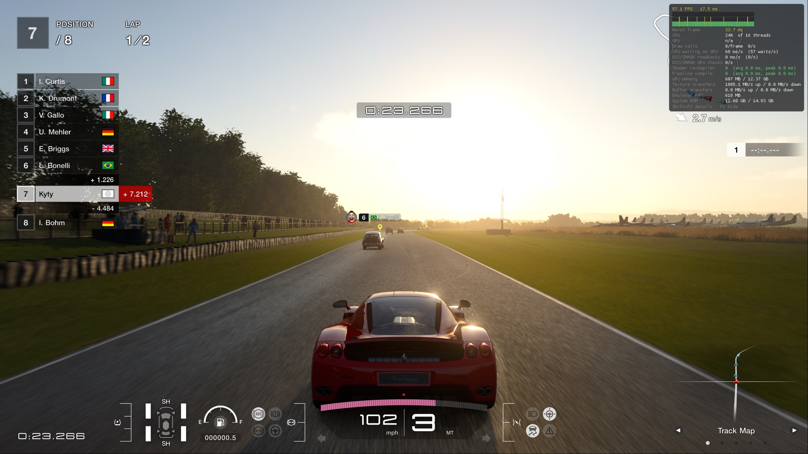
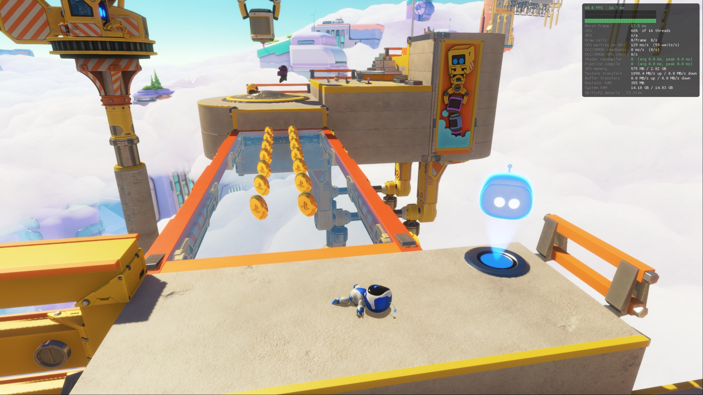
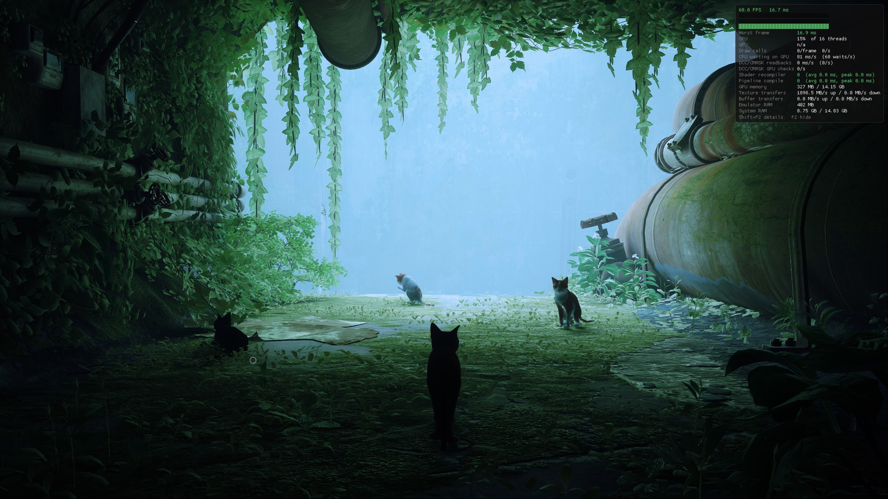
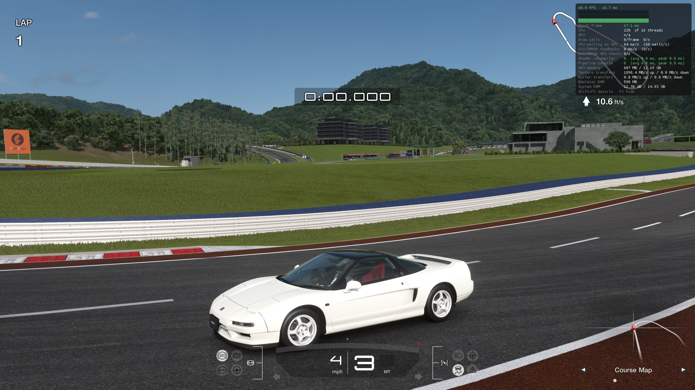
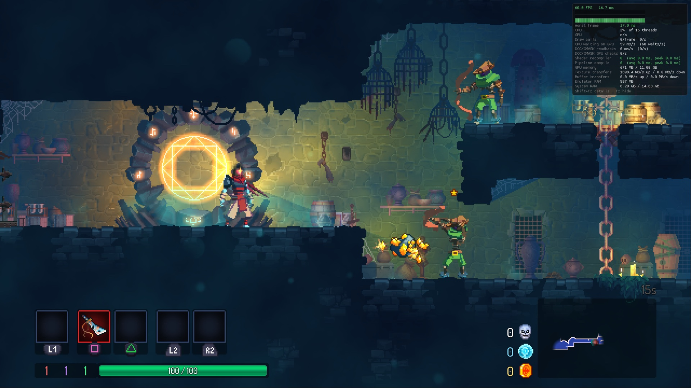

# KytyPS5-Native

PS5 games natively on the PS5 chip under Linux.

A fork of [KytyPS5](https://github.com/KytyPS5/KytyPS5) that runs PS5 games GPU work natively on the
AMD BC-250. The BC-250 has the PS5's APU ("Oberon", GPU gfx1013), so the title's command buffers
run on the hardware after a light translation, and its shaders run with small patches. Vulkan stays for
presentation and as a fallback. It will likely run on a PS5 under Linux too.

> [!IMPORTANT]
> Not affiliated with Sony Interactive Entertainment or PlayStation. No games or system software are
> distributed. Use only game files you obtained legally.

## Status

<table align="center">
  <tr>
    <td align="center">
      <strong>Gran Turismo 7</strong> (60 fps in races)<br>
      
    </td>
    <td align="center">
      <strong>ASTRO BOT</strong> (levels playable)<br>
      
    </td>
  </tr>
  <tr>
    <td align="center">
      <strong>Stray</strong> (60 fps)<br>
      
    </td>
    <td align="center">
      <strong>My First Gran Turismo</strong> (60 fps)<br>
      
    </td>
  </tr>
  <tr>
    <td align="center">
      <strong>Dead Cells</strong> (60 fps)<br>
      
    </td>
  </tr>
</table>

## Install

### SteamOS (recommended), Bazzite, CachyOS: Decky plugin

1. Install [Decky Loader](https://decky.xyz) and turn on its developer mode
2. Download the latest `KytyPS5-Native-*-Decky.zip` from [Releases](https://github.com/superkeka/KytyPS5-Native/releases)
3. Decky settings > Developer > Install Plugin from ZIP File
4. In the plugin: Kernel config > Apply and reboot, then Install, then pick the games folder

Games show up in the Steam library under Non-Steam as "Game (PS5)". The PS / Xbox button,
Share+Options together or F10 open the in-game menu (resume, monitoring, exit game). The plugin
keeps KytyPS5-Native and itself up to date.

### Other systems

Download the latest `KytyPS5-Native-*-Linux-x86_64.tar.gz` from
[Releases](https://github.com/superkeka/KytyPS5-Native/releases) and unpack it.

```bash
sudo ./install-helper.sh   # the root helper as a service (LOD statistics, KFD TLB flushes)
./kyty_launcher
```

On the BC-250 native mode turns on by itself; `KYTY_NATIVE_GPU=0` turns it off.
`kyty_emulator --game /path/to/game` runs a game without the launcher, `kyty_emulator --help` lists
the options.

## Requirements

- BC-250 with SteamOS (tested), stock or patched amdgpu
- GTT 14 GiB (`ttm.pages_limit=3670016`). Without it games over 8 GiB of guest memory stall loading
- Recommended: `options amdgpu sched_policy=2 vm_update_mode=0 cwsr_enable=0`, or the patched amdgpu

The plugin sets both. Kernel modes and how to set them by hand: [`tools/bc250-amdgpu`](tools/bc250-amdgpu/README.md).

## Build

On SteamOS inside a [Distrobox](https://distrobox.it/) container with Clang, CMake, Ninja,
glslang and the SDL3 development libraries:

```bash
git submodule update --init --recursive
cmake -S . -B _Build/linux-no-qt -G Ninja -DCMAKE_BUILD_TYPE=Release \
  -DCMAKE_C_COMPILER=clang -DCMAKE_CXX_COMPILER=clang++ -DKYTY_BUILD_LAUNCHER=OFF
cmake --build _Build/linux-no-qt --target kyty_emulator --parallel
```

The helper `kyty-lodhw` is built with the emulator.

## Native backend

Code: [`src/graphics/native_gpu`](src/graphics/native_gpu).

- [Streamed DCBs](docs/native-gpu-streamed-dcbs.md): the GPU starts while the translation goes on
- [Debugging GPU hangs](docs/native-gpu-hang-debugging.md)
- [PS5 legacy GCN mode](docs/ps5-legacy-gcn-mode.md)
- [`tools/bc250-native-probe`](tools/bc250-native-probe/README.md): hardware probes
- [`tools/bc250-frame-diff`](tools/bc250-frame-diff/README.md): native and Vulkan frames compared

## License

[GNU General Public License version 2](LICENSE) (`GPL-2.0-only`). Based on
[Kyty](https://github.com/InoriRus/Kyty) (MIT, notice in [`LICENSES/Kyty-MIT.txt`](LICENSES/Kyty-MIT.txt)).
Third-party components keep their own licenses.

## Thanks

- [KytyPS5](https://github.com/KytyPS5/KytyPS5): the translation layer this fork builds on
- [InoriRus/Kyty](https://github.com/InoriRus/Kyty): the original Kyty
- [shadps4-emu/shadPS4](https://github.com/shadps4-emu/shadPS4): PS4 memory, GPU aliasing, cache
  coherency and AVPlayer reference
